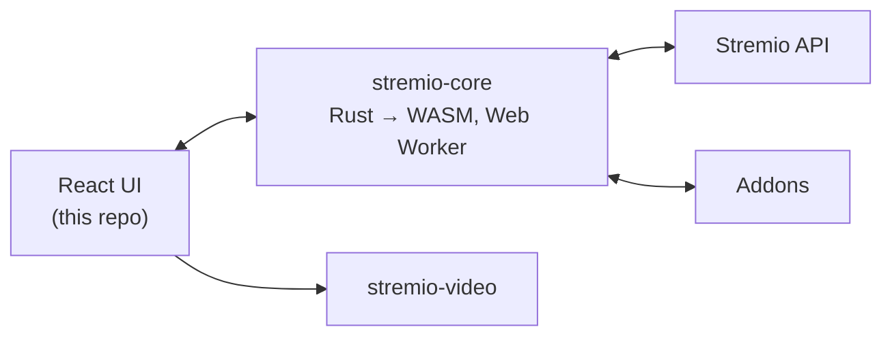

> **Codio note:** this folder is a modified copy of [Stremio/stremio-web](https://github.com/Stremio/stremio-web) (GPL-2.0), forked at upstream commit 55d8b33 (2026-11-03). Changes by Cody in 2026-11: Smart auto-play, the Codio look, hooks for Codio's native screens, no torrent sources, and Stremio artwork replaced with plain images. It is the engine that runs hidden inside the Codio iPhone and Android apps. The upstream copyright and license notice is kept at the end of this file.

# Codio (fork of Stremio Web)

This fork adds **Smart auto-play**: choose a quality (4K, 1440p, 1080p, 720p, 480p) and Stremio
starts the best matching source for you. If a source fails, doesn't start in time, or turns out to be
lower resolution than its label promised, it jumps to the next matching source automatically.

It is **optional and off by default**. Turn it on in **Settings > Smart auto-play**, where you can set:

- Preferred quality, and what to do if it isn't available (closest quality, same-or-lower only, exact only)
- Prefer debrid-cached / instant sources
- Words that should never be auto-picked (CAM, TS, TELESYNC, ...)
- Countdown before playing (with Play now / Cancel), and how long to wait for slow addons
- When to jump to the next source: on playback errors, if it doesn't start within N seconds,
  if the real resolution is lower than promised; plus a maximum number of sources to try

While playing, a small panel shows which source is playing (for example "source 2/6, 1080p") with a
**Next source** button.

## Windows

`windows/` contains a small launcher (`launcher.js`, started by `Codio.vbs`) that runs on
Stremio's own bundled runtime, serves this UI locally and starts the official Stremio for Windows app
with `--webui-url`, so you keep Stremio's mpv player. Because Stremio's streaming server only accepts
its own origins, `patches/@stremio__stremio-video@0.0.103.patch` makes plain http(s) streams (debrid /
HTTP addons) go straight to the player when the server can't be reached. Build the zip with
`./windows/package.sh`. See `windows/README.txt` for end-user instructions.

The UI also has a dark/red streaming-app theme, a featured banner on the home screen, and a
"Hide sources" mode (Play button for movies, episodes start immediately).

## Where the code is

- `src/common/AutoPlay/` settings storage, quality detection and ranking, and the source queue
- `src/routes/MetaDetails/StreamsList/AutoPlay/` picks a source and shows the countdown banner
- `src/routes/Player/useAutoPlayFallback.ts` jumps to the next source; `Player/AutoPlayIndicator/` is the panel
- `src/routes/Settings/AutoPlay/` the settings section

---

<div align="center">


# Stremio Web

**Freedom to Stream** — the official web UI of [Stremio](https://www.stremio.com), a modern media center that's a one-stop solution for your video entertainment.

[](https://github.com/Stremio/stremio-web/actions/workflows/build.yml)
[](https://stremio.github.io/stremio-web/development)
[](https://github.com/Stremio/stremio-web/releases)
[](/LICENSE.md)

**[🌐 Open the Web App](https://web.stremio.com)** · [Website](https://www.stremio.com) · [Report a bug](https://github.com/Stremio/stremio-web/issues/new/choose)


</div>

## ✨ Features

- 🧩 **Addon-powered** — discover movies, series and channels from catalogs provided by [addons](https://web.stremio.com/#/addons)
- 🔄 **Sync everywhere** — your library and Continue Watching follow your Stremio account across devices
- 📺 **Casting** — play on the big screen via Chromecast
- 💬 **Subtitles** — addon-provided or local, with customizable styling
- ⌨️ **Keyboard-first player** — full playback control without touching the mouse
- 🌍 **50+ languages** — community-translated via [stremio-translations](https://github.com/Stremio/stremio-translations)
- 📱 **Installable** — runs as a standalone PWA

## 📸 Screenshots

| Discover | Meta Details |
|:---:|:---:|
|  |  |

## 🛠 How it works

The UI (this repo) is a React app, but the brains live in [stremio-core](https://github.com/Stremio/stremio-core) — Stremio's Rust engine compiled to WebAssembly and running in a Web Worker. The UI renders state, the core computes it. Playback goes through [stremio-video](https://github.com/Stremio/stremio-video), which picks the right player implementation for the environment.



## 🚀 Getting started

You'll need [Node.js](https://nodejs.org) 22+ and [pnpm](https://pnpm.io/installation) 11+.

```bash
pnpm install
pnpm start
```

The dev server runs at `http://localhost:8080`.

| Command | Description |
|---|---|
| `pnpm start` | Development server with hot reload |
| `pnpm run start-prod` | Development server in production mode |
| `pnpm run build` | Production build |
| `pnpm test` | Run tests |
| `pnpm run lint` | Lint the source |
| `pnpm run scan-translations` | Check for missing translation keys |

### 🐳 Docker

```bash
docker build -t stremio-web .
docker run -p 8080:8080 stremio-web
```

## 🤝 Contributing

Bug reports and pull requests are welcome — [`good first issue`](https://github.com/Stremio/stremio-web/labels/good%20first%20issue) is a great place to start. Want Stremio in your language? Contribute to [stremio-translations](https://github.com/Stremio/stremio-translations). Please read the [Code of Conduct](/CODE_OF_CONDUCT.md) first.

## 🧩 Ecosystem

| Repository | What it is |
|---|---|
| [stremio-core](https://github.com/Stremio/stremio-core) | Rust engine: state, addon protocol, library, sync |
| [stremio-video](https://github.com/Stremio/stremio-video) | Video player abstraction used by this UI |
| [stremio-translations](https://github.com/Stremio/stremio-translations) | Community translations |
| [stremio-addon-sdk](https://github.com/Stremio/stremio-addon-sdk) | Build your own addon in Node.js |

## 💬 Community

[Website](https://www.stremio.com) · [Blog](https://blog.stremio.com) · [Reddit](https://www.reddit.com/r/Stremio) · [X](https://x.com/stremio) · [Help center](https://stremio.zendesk.com/hc/en-us)

## 📄 License

Copyright © 2017-2026 Smart Code OOD. Released under the GPL-2.0 license — see [LICENSE](/LICENSE.md).
